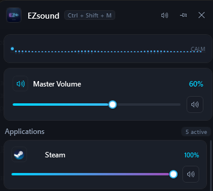
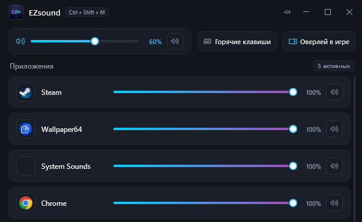

# EZsound

EZsound is a lightweight Windows per-application audio mixer with a floating game overlay built with WPF and .NET 9. It allows adjusting individual application volume levels, system master sound, and viewing real-time master audio activity without switching out of your active game or desktop workspace.

[](https://dotnet.microsoft.com/)
[](https://www.microsoft.com/windows)
[](LICENSE)

---

## Limitations

- **Exclusive Fullscreen**: EZsound's overlay operates as a topmost WPF desktop window. It renders over desktop applications and games running in **Borderless Windowed** or **Windowed** modes. Games running in **Exclusive Fullscreen** capture the display hardware directly, preventing standard desktop windows from drawing on top. For in-game overlay access, set your game display mode to Borderless Windowed.
- **Anti-Cheat Restrictions**: Some aggressive kernel-level anti-cheat software may block global keyboard hooks or the Win32 `RegisterHotKey` API, which can prevent the overlay shortcut from triggering while that game is focused.

---

## Screenshots

<!-- Add screenshots here -->




---

## Features

- **Per-Application Volume**: Control volume and mute states for any running application via Windows Core Audio (`ISimpleAudioVolume`).
- **Master Volume**: System-wide volume slider and mute control (`IAudioEndpointVolume`).
- **Real-Time Detection**: Dynamic session registration through `IAudioSessionNotification` and `IAudioSessionEvents` detects new audio streams immediately without restarting the mixer.
- **Floating Game Overlay**: Compact, semi-transparent overlay window summoned via global hotkey with smooth fade transitions.
- **Master Audio Wave Visualizer**: Hardware-accelerated equalizer wave visualizer capturing master output via WASAPI loopback. Rendering automatically suspends when hidden to conserve system resources.
- **System Tray Integration**: Background execution via Windows notification area icon with single-click overlay toggle and context menu.
- **Settings Persistence**: Saves overlay screen coordinates, visualizer toggles, and window states in `%APPDATA%\EZsound\settings.json`.
- **Process Metadata Resolution**: Resolves process names and icons across 32-bit and 64-bit boundaries without requiring administrator privileges.

---

## Requirements

- **Operating System**: Windows 10 (version 2004 / build 19041 or later) or Windows 11 (x64)
- **Runtime**: [.NET 9.0 Desktop Runtime](https://dotnet.microsoft.com/download/dotnet/9.0) (not required if built as self-contained)

---

## Installation

1. Download the latest `EZsound.exe` from the GitHub **Releases** page.
2. Place `EZsound.exe` in any folder of your choice and launch it.
3. The application will start in the system tray and display the main mixer window.

---

## Usage

### Hotkeys and Controls

| Action | Input | Description |
| :--- | :--- | :--- |
| **Toggle Overlay** | `Ctrl + Shift + M` | Shows or hides the floating game overlay from any application |
| **Dismiss Overlay** | `Esc` | Dismisses the overlay when focused |
| **Move Window** | `Left Click + Drag` | Drag from the header area to reposition either window |
| **Pin Always on Top** | Pin Icon (Header) | Keeps the overlay or main window pinned above all other windows |
| **Quick Toggle (Tray)** | Single Left-Click | Toggles the floating overlay from the taskbar notification area |
| **Open Main Window** | Tray Menu &rarr; Open | Opens the primary desktop mixer window |
| **Exit Application** | Tray Menu &rarr; Exit | Closes all windows, stops background audio capture, and terminates |

---

## Building from Source

### Prerequisites
- [.NET 9.0 SDK](https://dotnet.microsoft.com/download/dotnet/9.0)
- Git

### Build Commands

```bash
# Clone the repository
git clone https://github.com/AmirUzak/EZsound.git
cd EZsound

# Build in Release mode
dotnet build src/EZsound/EZsound.csproj -c Release

# Publish a framework-dependent release binary
dotnet publish src/EZsound/EZsound.csproj -c Release -r win-x64 --self-contained false -o publish

# Or publish a self-contained single-file binary (no runtime required on target machine)
dotnet publish src/EZsound/EZsound.csproj -c Release -r win-x64 --self-contained true -p:PublishSingleFile=true -o publish-standalone
```

---

## Project Structure

```
EZsound/
├── docs/                      # Documentation assets and screenshots
│   └── .gitkeep
├── src/
│   └── EZsound/
│       ├── Converters/        # WPF XAML value converters
│       ├── Helpers/           # Process inspection and icon extraction utilities
│       ├── Models/            # Audio session data models and JSON settings
│       ├── Resources/         # Application icons and graphics
│       ├── Services/          # Audio engine, WASAPI loopback, hotkeys, and tray services
│       ├── ViewModels/        # MVVM viewmodels and relay command infrastructure
│       └── Views/             # WPF windows and visualizer drawing canvas
├── CHANGELOG.md               # Version history and release notes
├── LICENSE                    # MIT License
└── README.md                  # Project documentation
```

---

## Architecture Notes

### Audio Engine & Session Synchronization
The core audio stack is built on Windows Core Audio APIs using NAudio interop wrappers. `AudioService` monitors the default multimedia audio endpoint via `MMDeviceEnumerator`. When an application starts or stops outputting audio, Windows signals `IAudioSessionNotification`, which updates the thread-safe session dictionary. Events are dispatched onto the WPF UI thread, keeping the `ObservableCollection<AudioSessionViewModel>` inside `MainViewModel` in sync across both `MainWindow` and `OverlayWindow` without polling overhead.

### Master Audio Wave Visualizer
Real-time audio visualization is handled by `AudioCaptureService` using `WasapiLoopbackCapture` on the active playback device. Audio sample buffers are analyzed to calculate root-mean-square (RMS) and peak energy. The custom `MasterWaveVisualizer` element hooks into `CompositionTarget.Rendering` to render animated equalizer bars via WPF `DrawingContext`. When the window is hidden or minimized, animation rendering hooks are detached to eliminate idle CPU and GPU consumption.

### Shell Interop & Hotkeys
Global hotkey detection (`Ctrl + Shift + M`) is powered by `HotkeyService`. It implements a Win32 message-only window (`HWND_MESSAGE` parent) through `System.Windows.Forms.NativeWindow`, registering via `RegisterHotKey`. Because the listener window is message-only, it does not appear in Alt-Tab switchers or top-level window lists. Application lifetime and notification area interactions are managed by `TrayIconService` and `WindowManagementService`.

---

## Roadmap

- [ ] Autostart with Windows toggle in settings
- [ ] Hotkey customization user interface
- [ ] Per-application audio output device routing
- [ ] Configurable audio volume presets and profiles

---

## License

This project is licensed under the MIT License - see the [LICENSE](LICENSE) file for details.
